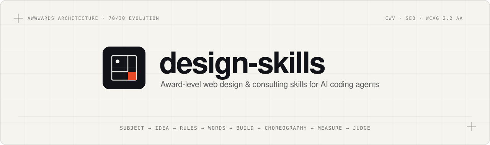

<p align="center">
  <picture>
    <source media="(prefers-color-scheme: dark)" srcset="assets/design-skills-banner-dark.svg">
    <source media="(prefers-color-scheme: light)" srcset="assets/design-skills-banner-light.svg">
    
  </picture>
</p>

<div align="center">

# Design Skills for Non-Designers

<code>npx skills@latest add fadhilafif98/design-skills</code>

[Why](#why-use-it) · [Install](#install) · [Usage](#usage) · [Skills](#skills) · [Modes & Surfaces](#modes-and-surface-profiles) · [Changelog](CHANGELOG.md) · [FAQ](#faq)

[](CHANGELOG.md)
[](package.json)
[](https://skills.sh/fadhilafif98/design-skills)
[](skills/awwwards-web-design/references/awwwards-references.md)
[](skills/awwwards-web-design/scripts/inspect.mjs)
[](LICENSE)

</div>

---

**design-skills** turns an AI coding agent into your creative director, UX architect, and design engineer. Built for founders, developers, and small business owners who want award-level, conversion-ready websites without being designers. Type a plain prompt like *"build a website for my specialty coffee roastery in Portland"*: the agent extracts what only your business has, locks a curated Awwwards reference blueprint (70% proven architecture / 30% bespoke evolution), generates art-directed photography via AI, builds real scroll/motion choreography, measures the live page in Chromium (layout, Core Web Vitals, Technical SEO, WCAG 2.2 AA), and has an independent fresh-context critic score the result.

## Why use it

Agents don't have taste on their own. Give an AI a short prompt and it fills every undecided layer with the average of the internet. Tell it to avoid that, and it gives you the predictable opposite: cream ground, serif headline, terracotta accent, mono micro-labels, and `01/02/03`. Both are the rut.

These skills replace defaults with written decisions, and verify every layer with tools instead of hope:

```text
Subject → Idea → Rules → Words → Build → Choreography → Measure → Judge
```

- **Ideas come from your business, not your category.** The agent inventories 8–12 facts only you have (name, street, numbers, rituals, constraints), builds an idea sentence, and runs a competitor swap test.
- **70% Reference Architecture / 30% Subject Evolution.** Matches your brief to 15 curated blueprints in [`awwwards-references.md`](skills/awwwards-web-design/references/awwwards-references.md) (*Emotion Agency*, *LXL Creative*, *Era Residence*, *Oryzo AI*, *Anime.js*, *Santioni Spirits*, *Mejuma Tuscany*, etc.)—keeping 70% of the proven spatial/motion foundation and evolving 30% from your business.
- **IA, UX Psychology & Conversion built in.** Classifies the site's surface (`experience`, `persuade`, `operate`, `read`), maps multi-page sitemaps and conversion funnels, applies Laws of UX, and designs full UI states (`idle`, `loading`, `empty`, `error`, `success`).
- **Bespoke AI imagery first.** Generates cohesive art-directed visuals via `image-generator` matching the reference's lighting and color grade—no generic stock scraping.
- **One live thing.** Every site ships a custom interactive instrument with real content (e.g. roast schedule explorer, live scope/treatment configurator, interactive lookbook) plus a semantic `<noscript>` fallback.
- **Measured in a real browser, not eyeballed.** `inspect.sh` runs Chromium across `1440 / 768 / 390 / 320px`, `prefers-reduced-motion`, and no-JS. It measures headline lines, contrast, overflow, fonts, first-screen ambition, choreography, **Core Web Vitals (LCP, CLS, transfer weight)**, **Technical SEO (title, meta, Open Graph, JSON-LD, heading order)**, and **WCAG 2.2 AA (`img[alt]`, accessible names, form labels, landmarks, tap targets)**.
- **Judged by fresh eyes.** A separate subagent sees only the screenshots, brief, and reference blueprint—scoring like an Awwwards juror with hard caps that block grade inflation.
- **The brand never drifts & no invented proof.** Identity is `LOCKED`, taste moves within `FLEXIBLE` bounds (`brand-check.mjs` lints every checkpoint), and missing real facts stay marked `[FILL: …]`, `REPLACE:`, `CONFIRM:`, or `SAMPLE`.

## Install

```bash
npx skills@latest add fadhilafif98/design-skills
```

Install a single skill, or install globally for Claude Code:

```bash
npx skills@latest add fadhilafif98/design-skills --skill awwwards-web-design
npx skills@latest add fadhilafif98/design-skills -a claude-code -g
```

Install both for the full workflow. `design-consulting` works standalone, and automatically borrows `inspect.sh`, `brand-check.mjs`, and references from `awwwards-web-design` when present.

### Manual install

Clone the repository and symlink the skills into your agent's skills directory (e.g. `~/.claude/skills` or `$CLAUDE_CONFIG_DIR/skills`):

```bash
ln -s "$PWD/skills/awwwards-web-design" ~/.claude/skills/awwwards-web-design
ln -s "$PWD/skills/design-consulting"   ~/.claude/skills/design-consulting
```

Start a new session afterwards so the agent loads the skills.

**Requirements:** Node 18+. The first `inspect.sh` run installs Playwright and Chromium into `~/.cache/awwwards-web-design` (requires network once).

## Usage

```text
build a website for my specialty coffee roastery in Portland
```

```text
/awwwards-web-design landing page for my interior design studio
```

```text
/design-consulting audit https://my-site.com
```

- **Autopilot:** Say **"up to you"** or **"just build it"** and the agent asks no questions—writes its assumptions, commits to the single best reference blueprint, generates visuals, and builds the complete experience.
- **Plain-word feedback:** React naturally (*"doesn't feel premium enough"*, *"too cluttered"*, *"looks AI-generated"*). The agent translates feelings into exact CSS/layout/motion levers without touching your locked brand.

## Skills

| Skill | Role | Pick it for |
|---|---|---|
| [`awwwards-web-design`](skills/awwwards-web-design/SKILL.md) | Build (10 phases + ledger) | Creating or redesigning a website, landing page, portfolio, company profile, or storefront end-to-end |
| [`design-consulting`](skills/design-consulting/SKILL.md) | Advise (5 modes) | Discovery briefs, measured UX/SEO/brand audits, comparing design options, translating vague feedback, or locking a brand book |

<details>
<summary><strong>What's inside <code>awwwards-web-design</code> (10 phases, 18 references, 4 CLI tools)</strong></summary>

Ten phases tracked in `design/decisions.md` so no step is silently skipped:
`Phase 0` Resume/Import → `Phase 1` Intake, Surface & Sitemap/IA → `Phase 2` Reference Match & AI Assets → `Phase 3` Lock Tokens & Brand → `Phase 4` Argument, Conversion & Copy → `Phase 5` Build + SEO/CWV/WCAG → `Phase 6` Choreography (GSAP/Lenis/Anime/Three) → `Phase 7` Stress Test & Pre-Launch QA → `Phase 8` Fresh-Eyes Critique → `Phase 9` Report.

| Module | What it covers |
|---|---|
| [`awwwards-references.md`](skills/awwwards-web-design/references/awwwards-references.md) | 15 curated Awwwards blueprints (hero mechanism, section rhythm, motion stack, multi-chapter colour rules) |
| [`awwwards-patterns.md`](skills/awwwards-web-design/references/awwwards-patterns.md) | 12 buildable hero compositions, measured ambition floor, recurring Site of the Day moves |
| [`creative-direction.md`](skills/awwwards-web-design/references/creative-direction.md) · [`art-directions.md`](skills/awwwards-web-design/references/art-directions.md) | Subject inventory, rut naming, 70/30 reference matching, idea sentence, live thing, 12 composition grammars |
| [`ia-ux-conversion.md`](skills/awwwards-web-design/references/ia-ux-conversion.md) | Surface classes (`experience`/`persuade`/`operate`/`read`), sitemap & multi-page IA, Laws of UX, conversion funnel, UI states matrix, content handoff |
| [`seo-perf-launch.md`](skills/awwwards-web-design/references/seo-perf-launch.md) · [`modern-web-platform.md`](skills/awwwards-web-design/references/modern-web-platform.md) | Technical SEO, Open Graph, JSON-LD, Core Web Vitals & image pipeline, WCAG 2.2 AA, Web Platform Baseline fallbacks, native `<dialog>`/`popover`/Anchor Positioning/`@container` |
| [`tells.md`](skills/awwwards-web-design/references/tells.md) · [`copy.md`](skills/awwwards-web-design/references/copy.md) | Dated 3-wave registry of AI-generated tells, argument-first copy, 2-line headline arithmetic, truth rules |
| [`typography.md`](skills/awwwards-web-design/references/typography.md) · [`layout-composition.md`](skills/awwwards-web-design/references/layout-composition.md) · [`visual-craft.md`](skills/awwwards-web-design/references/visual-craft.md) | Verified font procedure, modular scale, frame & fullness, OKLCH colour, AI imagery rules |
| [`motion-playbook.md`](skills/awwwards-web-design/references/motion-playbook.md) · [`interaction-details.md`](skills/awwwards-web-design/references/interaction-details.md) | Decision gate, exact curves, GSAP/Lenis/Anime/Three recipes, pressables, forms, gestures, mobile |
| [`stress-test.md`](skills/awwwards-web-design/references/stress-test.md) · [`critique.md`](skills/awwwards-web-design/references/critique.md) · [`brand-guardian.md`](skills/awwwards-web-design/references/brand-guardian.md) | Worst-case content states, 14-pass fresh-context juror rubric with caps, LOCKED/FLEXIBLE/FREE brand protocol |
| [`worked-examples.md`](skills/awwwards-web-design/references/worked-examples.md) | 3 full briefs (café, B2B SaaS, clinic) taken to a locked direction |
| [`inspect.sh`](skills/awwwards-web-design/scripts/inspect.sh) · [`brand-check.mjs`](skills/awwwards-web-design/scripts/brand-check.mjs) · [`lookup.mjs`](skills/awwwards-web-design/scripts/lookup.mjs) · [`deal.mjs`](skills/awwwards-web-design/scripts/deal.mjs) | Real-browser Playwright gate (CWV, SEO, WCAG, tells, ambition, surface profiles), brand/legacy-pattern linter, on-demand token-efficient lookup CLI, and optional font/direction roller |

</details>

<details>
<summary><strong>What's inside <code>design-consulting</code> (5 modes)</strong></summary>

- **Discovery:** turn a vague idea into a brief, subject inventory, recommended direction, and ready-to-paste build prompt.
- **Audit:** measured browser pass (`inspect.sh` + `brand-check.mjs`), independent fresh-context critique, and a prioritized Top 3 with exact fixes.
- **Decide:** weighted decision matrix + swap test across 2–5 options, picking one clear winner.
- **Translate:** map subjective words (*"premium but warm"*) into exact design levers and a prompt pack.
- **Brand:** consistency audit against an existing brand book, or create `BRAND.md` + `brand.json` locks.

</details>

## Modes and surface profiles

### Build modes (`awwwards-web-design`)

| Mode | When to use | Scope |
|---|---|---|
| **Quick** | Single section, component, or restyle | Reuses existing brand locks, 1 critique round |
| **Standard** *(default)* | New website or landing page | All 10 phases, 1 fresh-eyes critique round (≤ 20 min budget) |
| **Full** | Award-level showcase or flagship redesign | All 10 phases, full stress test, up to 3 critique rounds |

### Surface profiles (`inspect.sh --surface`)

Declare `"surface"` in `design/brand.json` or pass `--surface` to `inspect.sh` so automated checks match the page's job:

| Surface | Best for | Behaviour |
|---|---|---|
| `experience` *(default)* | Portfolio, hospitality, editorial campaign | Full Awwwards strictness (ambition, choreography, multi-chapter surfaces) |
| `persuade` | SaaS landing, company profile, clinic, storefront | Enforces clarity, conversion, SEO, CWV, WCAG; softens campaign-only tells to warnings |
| `operate` | Web app, dashboard, booking portal | Relaxes campaign-only rules (`card-grid`, `static-page`, `rigid-header`, `timid-hero`) |
| `read` | Docs, blog, long-form editorial | Relaxes campaign-only rules; enforces typography, contrast, heading order, and landmarks |

## Proving it works

```bash
# 1. Source linter, legacy-pattern & brand-lock regression tests (22 tests)
npm test

# 2. On-demand blueprint/reference lookup (token-efficient CLI)
npm run lookup -- list
npm run lookup -- blueprint era-residence

# 3. Browser inspector against the planted-defect fixture (experience vs operate)
bash skills/awwwards-web-design/scripts/inspect.sh skills/design-consulting/evals/files/slop-site/index.html --name fixture --shots page
bash skills/awwwards-web-design/scripts/inspect.sh skills/design-consulting/evals/files/slop-site/index.html --surface operate --name fixture-op

# 4. Unguided baseline vs guided skill uplift comparison
npm run eval:compare -- <baseline.html> <guided.html> --surface experience
```

Behaviour evals live in `skills/*/evals/evals.json`. See [evals/README.md](evals/README.md) for running them against a no-skill baseline.

## FAQ

**Does this guarantee an Awwwards Site of the Day?**
No. Juries decide, and your real content (photography, copy, product, brand) is the biggest factor. The skills enforce award-level architecture, report scores honestly (never rounding up), and flag every placeholder slot (`[FILL: …]`, `REPLACE:`, `CONFIRM:`, `SAMPLE`) for you to fill.

**Can I use this for a normal business site, SaaS, or e-commerce—not just artsy portfolios?**
Yes. Set `"surface": "persuade"` or `"operate"` in `design/brand.json` (or `--surface persuade` in `inspect.sh`). You keep full conversion, IA, SEO, Core Web Vitals, and WCAG 2.2 AA rigor without campaign-only rules fighting usability.

**Does it work if I already have a brand book or an existing codebase?**
Yes. Phase 0 runs in **Import mode** (`brand-guardian.md` §3): your logo, colours, and fonts are locked in `BRAND.md` and `brand.json`, and redesigns preserve your existing stack, routes, and forms.

**Which AI coding agents are supported?**
Any agent that supports the Agent Skills standard (`SKILL.md`), including Claude Code, Antigravity, Cursor, Codex, OpenCode, Gemini CLI, and GitHub Copilot.

## Star History

[](https://star-history.com/#fadhilafif98/design-skills&Date)

<hr>

<p align="center"><em>“Taste is trained, not guessed.<br>
Replace defaults with decisions, measure them in a real browser,<br>
and read the <strong>why</strong> behind every fix.”</em></p>

<hr>

## Credits & License

Built on ideas from [emilkowalski/skills](https://github.com/emilkowalski/skills), [pbakaus/impeccable](https://github.com/pbakaus/impeccable), [leonxlnx/taste-skill](https://github.com/leonxlnx/taste-skill), [garrytan/gstack](https://github.com/garrytan/gstack), Anthropic's [frontend-design](https://github.com/anthropics/skills), [GoogleChrome/modern-web-guidance](https://github.com/GoogleChrome/modern-web-guidance), Elementor's Web Design Guide, Laws of UX, NN/g, Baymard, Refactoring UI, and Google web.dev. Licences and attributions: [NOTICE.md](NOTICE.md).

MIT: [LICENSE](LICENSE)
